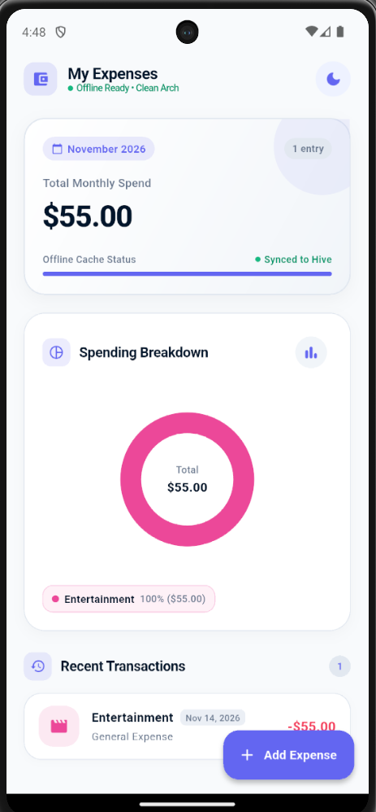
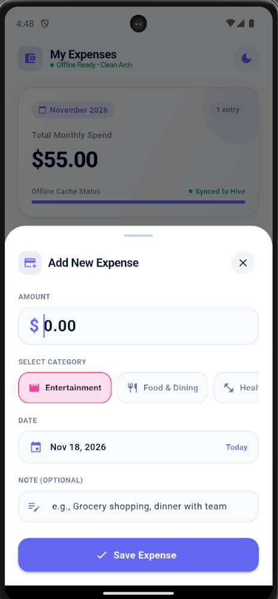
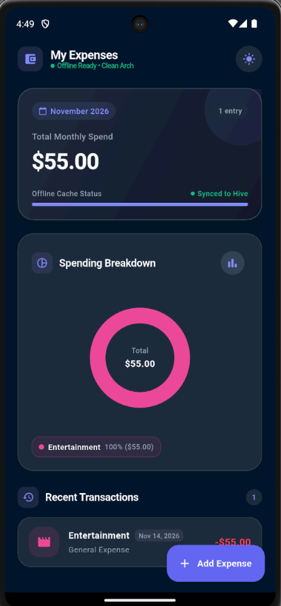
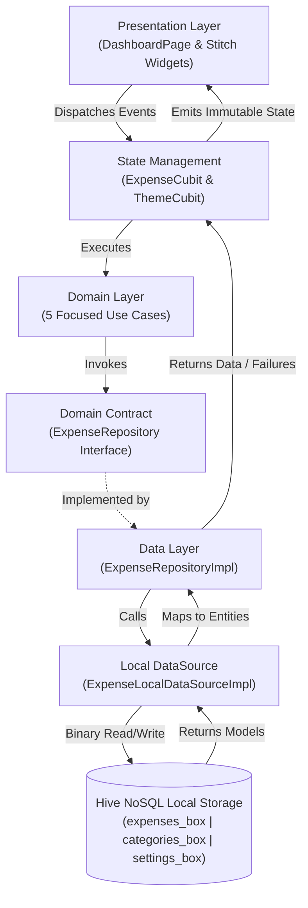

# Auspify Expense Tracker App (Task 4)

[](https://flutter.dev)
[](https://dart.dev)
[](https://pub.dev/packages/flutter_bloc)
[](https://pub.dev/packages/hive)
[](https://pub.dev/packages/fl_chart)
[](https://blog.cleancoder.com/uncle-bob/2012/08/13/the-clean-architecture.html)
[](#testing--quality-assurance)
[](LICENSE)

A production-grade, **100% offline-first** personal finance application developed for the **Auspify Technologies 4-Week Practical Learning Internship Program (Task 4)**.

Built with **Clean Architecture**, **Cubit (`flutter_bloc`)**, and **Hive NoSQL**, the app enables fast daily expense logging, categorized spending analysis via interactive **`fl_chart`** Donut and Bar visualizations, swipe-to-delete with instant undo recovery, and persistent Light/Dark Material 3 themes crafted from the **Google Stitch** design system.

---

## 📸 App Screenshots

| Dashboard (Light Mode) | Add Expense Form | Dashboard (Dark Mode) |
| :---: | :---: | :---: |
|  |  |  |

---

## Key Features

* **Offline-First NoSQL Persistence (Hive)**:
  * Zero network dependency with blazing-fast synchronous local reads/writes across `expenses_box`, `categories_box`, and `settings_box`.
  * Custom type-safe binary `TypeAdapter` implementations (`CategoryModelAdapter`, `ExpenseModelAdapter`) for zero code-gen overhead.
  * Automatic first-launch seeding of 6 predefined spending categories.
* **Total Spend Hero Dashboard**:
  * Elevated Material 3 summary card highlighting month-to-date total spending, current month pill, transaction entry count, and real-time Hive sync status indicator.
* **Interactive Data Visualization (`fl_chart`)**:
  * **Donut (Pie) Chart**: Category-colored slices with interactive touch highlights, dynamic center spend readout, and percentage badges.
  * **Bar Chart Mode**: One-tap toggle between Donut and Bar chart views with category icon axis labels and interactive tooltips.
  * **Dynamic Category Legend**: Automatically recalculates percentages and spend totals whenever expenses are added, edited, or deleted.
* **Full Expense Management (CRUD) & Form Validation**:
  * **Add & Edit Modal Bottom Sheet**: Large currency-prefixed numeric amount input with instant validation (`> $0`), animated horizontal category chips, native Material date picker (defaults to today), and optional contextual notes.
  * **Chronological Transaction History**: Newest-first sorted list with category-tinted icons, relative date tags (`Today` or `MMM dd, yyyy`), and formatted negative amounts (`-$XX.XX`).
  * **Swipe-to-Delete with Undo**: `Dismissible` gesture with delete confirmation SnackBar and an interactive **UNDO** button that immediately restores the record and recalculates charts.
* **Persistent Light & Dark Themes**:
  * Crafted from Google Stitch Material 3 design tokens (Indigo `#6366F1` / `#818CF8`, Slate `#F8FAFC` / `#0F172A`).
  * Smoothly animated AppBar theme switcher persisted locally across app restarts.

---

## Architecture & Data Flow

The project strictly enforces **Clean Architecture** across decoupled `core`, `domain`, `data`, and `presentation` layers with unidirectional state flow:



### Project Structure

```text
lib/
├── core/
│   ├── constants/
│   │   └── app_constants.dart            # Hive box identifiers, settings keys, defaults
│   ├── error/
│   │   ├── exceptions.dart               # CacheException, ValidationException
│   │   └── failures.dart                 # Failure base class, CacheFailure, ValidationFailure
│   ├── theme/
│   │   └── app_theme.dart                # Google Stitch M3 Light & Dark themes + AppColors
│   └── utils/
│       ├── currency_formatter.dart       # Currency, signed expense, and date formatting (intl)
│       └── icon_helper.dart              # Safe dynamic Material IconData resolver
├── domain/
│   ├── entities/
│   │   ├── category_entity.dart          # Immutable CategoryEntity (Equatable)
│   │   └── expense_entity.dart           # Immutable ExpenseEntity (Equatable)
│   ├── repositories/
│   │   └── expense_repository.dart       # Abstract repository contract
│   └── usecases/
│       ├── add_expense_usecase.dart      # Validates amount > 0 & category, persists
│       ├── delete_expense_usecase.dart   # Validates ID, deletes record
│       ├── get_categories_usecase.dart   # Fetches all categories
│       ├── get_expenses_usecase.dart     # Fetches chronological expenses
│       └── update_expense_usecase.dart   # Validates & updates existing record
├── data/
│   ├── datasources/
│   │   ├── expense_local_data_source.dart # Hive CRUD, sorting, seeding, theme settings
│   │   └── hive_registrar.dart           # Idempotent TypeAdapter registration helper
│   ├── models/
│   │   ├── category_model.dart           # CategoryModel + CategoryModelAdapter (typeId: 0)
│   │   └── expense_model.dart            # ExpenseModel + ExpenseModelAdapter (typeId: 1)
│   └── repositories/
│       └── expense_repository_impl.dart  # Bridges DataSource & maps exceptions to Failures
├── presentation/
│   ├── cubits/
│   │   ├── expense/
│   │   │   ├── expense_cubit.dart        # CRUD orchestration, spend totals, chart aggregations
│   │   │   └── expense_state.dart        # Initial, Loading, Loaded, Error states
│   │   └── theme/
│   │       ├── theme_cubit.dart          # Light/Dark toggle & Hive persistence
│   │       └── theme_state.dart          # Immutable ThemeMode state
│   ├── pages/
│   │   └── dashboard_page.dart           # Main screen assembling AppBar, Hero, Chart, List, FAB
│   └── widgets/
│       ├── add_expense_bottom_sheet.dart # Modal form for creating/editing transactions
│       ├── expense_card_widget.dart      # Individual transaction card
│       ├── expense_chart_widget.dart     # Interactive fl_chart Donut & Bar chart + legend
│       ├── expense_list_widget.dart      # Dismissible swipe-to-delete transaction list
│       └── total_spend_card.dart         # Hero total spend summary card
├── injection_container.dart              # Lightweight, type-safe Dependency Injection container
└── main.dart                             # Hive init, DI setup, MultiBlocProvider, MaterialApp
```

---

## Technology Stack

| Component | Technology / Package | Purpose |
| :--- | :--- | :--- |
| **Framework & Language** | Flutter 3.47 (Material 3), Dart 3.13 | Cross-platform mobile UI and sound null-safe codebase |
| **State Management** | `flutter_bloc`, `equatable` | Predictable Cubit state transitions & value equality |
| **Local NoSQL Storage** | `hive`, `hive_flutter` | Fast, encrypted-ready offline binary persistence |
| **Data Visualization** | `fl_chart` | Interactive Donut & Bar charts with touch callbacks |
| **Utilities** | `intl`, `uuid` | Currency/date formatting and RFC 4122 v4 UUID generation |
| **Testing** | `flutter_test`, `bloc_test`, `mocktail` | Comprehensive unit, Cubit, persistence, and widget testing |

---

## Local Data Schema (Hive NoSQL)

| Box Name | Stored Type | TypeId | Purpose |
| :--- | :--- | :---: | :--- |
| `expenses_box` | `ExpenseModel` | `1` | Stores `id`, `amount`, `categoryId`, `date`, and optional `note` |
| `categories_box` | `CategoryModel` | `0` | Pre-seeded with 6 categories: Food, Transport, Utilities, Entertainment, Health, Shopping |
| `settings_box` | `dynamic` | — | Stores `theme_mode_is_dark` boolean preference |

---

## Getting Started

### Prerequisites
* Flutter SDK `>=3.13.5`
* Dart SDK `>=3.13.5`

### Installation & Run

1. **Clone the repository:**
   ```bash
   git clone https://github.com/eslam4546/auspify_expense_tracker_app.git
   cd auspify_expense_tracker_app
   ```

2. **Install dependencies:**
   ```bash
   flutter pub get
   ```

3. **Run static analysis and the test suite:**
   ```bash
   flutter analyze
   flutter test
   ```

4. **Launch the application:**
   ```bash
   flutter run
   ```

---

## Testing & Quality Assurance

All architectural layers are verified with **28 automated tests** and strict static analysis:

```bash
flutter analyze   # 0 issues found
flutter test      # 28/28 tests passed
```

| Test Suite | Scope |
| :--- | :--- |
| `test/data/models/hive_adapters_test.dart` | Binary Hive read/write serialization for `CategoryModel` and `ExpenseModel` |
| `test/data/datasources/expense_local_data_source_test.dart` | 6-category seeding, newest-first sorting, CRUD operations, and theme persistence |
| `test/data/repositories/expense_repository_impl_test.dart` | Entity-model mapping and repository contract delegation |
| `test/domain/usecases/expense_usecases_test.dart` | Business rule enforcement (`amount > 0`, non-empty category/ID validation) |
| `test/presentation/cubits/theme_cubit_test.dart` | Theme startup restoration and Light/Dark state emissions |
| `test/presentation/cubits/expense_cubit_test.dart` | CRUD state transitions, total spend sum, and category map aggregation |
| `test/widget_test.dart` | `DashboardPage` widget rendering smoke test (AppBar, Hero Card, FAB) |

For a detailed phase-by-phase technical report, see [walkthrough.md](walkthrough.md).

---

## License

This project is licensed under the MIT License — see the [LICENSE](LICENSE) file for details.
