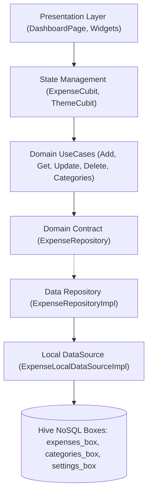

# Flutter Expense Tracker App (Task 4) — Final Walkthrough

## Executive Summary
Successfully designed, architected, implemented, and verified **Task 4 — Expense Tracker App** for the **Auspify Technologies Internship Program**. The application is a 100% offline-first personal finance tracker built with **Flutter (Material 3)**, **Clean Architecture**, **Cubit (`flutter_bloc`)**, **Hive NoSQL**, and interactive **`fl_chart`** data visualizations, faithfully implementing the UI/UX design retrieved from **Google Stitch** (`Flutter Expense Tracker UI`).

---

## Architecture Overview

The codebase strictly enforces Clean Architecture separation across four decoupled layers:

### Layer Breakdown & Key Files
1. **Core Layer (`lib/core/`)**
   - `lib/core/constants/app_constants.dart` — Box names, setting keys, and app defaults.
   - `lib/core/error/failures.dart` & `lib/core/error/exceptions.dart` — Structured error hierarchy (`CacheFailure`, `ValidationFailure`, `CacheException`, `ValidationException`).
   - `lib/core/utils/currency_formatter.dart` & `lib/core/utils/icon_helper.dart` — Formatting utilities via `intl` and safe dynamic icon resolution.
   - `lib/core/theme/app_theme.dart` — Google Stitch M3 Light & Dark themes (`#6366F1` Indigo, `#818CF8` Dark Indigo, `#F8FAFC` / `#0F172A` Slate surfaces).

2. **Domain Layer (`lib/domain/`)**
   - Entities: `expense_entity.dart`, `category_entity.dart` (`Equatable`, immutable).
   - Contract: `expense_repository.dart`.
   - UseCases: `get_expenses_usecase.dart`, `add_expense_usecase.dart`, `update_expense_usecase.dart`, `delete_expense_usecase.dart`, `get_categories_usecase.dart`.

3. **Data Layer (`lib/data/`)**
   - Models & TypeAdapters: `category_model.dart` (`typeId: 0`), `expense_model.dart` (`typeId: 1`).
   - Hive Registration & Storage: `hive_registrar.dart`, `expense_local_data_source.dart` (auto-seeds 6 Stitch categories on first boot and persists theme preference).
   - Repository Implementation: `expense_repository_impl.dart`.

4. **Presentation Layer & Assembly (`lib/presentation/`, `lib/`)**
   - State Management: `theme_cubit.dart`, `expense_cubit.dart` (computes `totalMonthlySpend`, `categorySpendMap`, slice touch highlights, and pie/bar view toggle).
   - Stitch UI Components:
     - `total_spend_card.dart` — Hero card with current month badge, entry count, total spend, and Hive sync bar.
     - `expense_chart_widget.dart` — Interactive `fl_chart` Donut & Bar chart toggle with touch feedback and percentage legend.
     - `expense_card_widget.dart` & `expense_list_widget.dart` — Chronological transaction list with `Dismissible` swipe-to-delete and UNDO snackbar.
     - `add_expense_bottom_sheet.dart` — Modal form with numeric validation (`> $0`), category chips, native date picker, and optional notes.
     - `dashboard_page.dart` — Full dashboard assembly.
   - Dependency Injection & Entry Point: `lib/injection_container.dart`, `lib/main.dart`.

---

## Verification & Quality Assurance

| Verification Step | Command Executed | Result |
| :--- | :--- | :--- |
| **Automated Test Suite** | `flutter test` | **28 / 28 tests passed** across all 7 test suites |
| **Static Code Analysis** | `flutter analyze` | **0 issues found** (zero errors, warnings, or lints) |
| **Code Formatting** | `dart format .` | **38 files formatted** cleanly |

### Test Coverage Breakdown
- `test/data/models/hive_adapters_test.dart` — Binary serialization/deserialization of `CategoryModel` & `ExpenseModel`.
- `test/data/datasources/expense_local_data_source_test.dart` — Category seeding, chronological sorting, CRUD, and theme persistence.
- `test/data/repositories/expense_repository_impl_test.dart` — Entity/Model translation and repository delegation.
- `test/domain/usecases/expense_usecases_test.dart` — Validation rules (amount `> 0`, non-empty category/ID) across all 5 UseCases.
- `test/presentation/cubits/theme_cubit_test.dart` — Light/Dark mode initialization and persistence toggling.
- `test/presentation/cubits/expense_cubit_test.dart` — State emissions, CRUD flows, and chart spend aggregations.
- `test/widget_test.dart` — `DashboardPage` UI smoke test (AppBar, Total Spend Hero Card, FAB).
